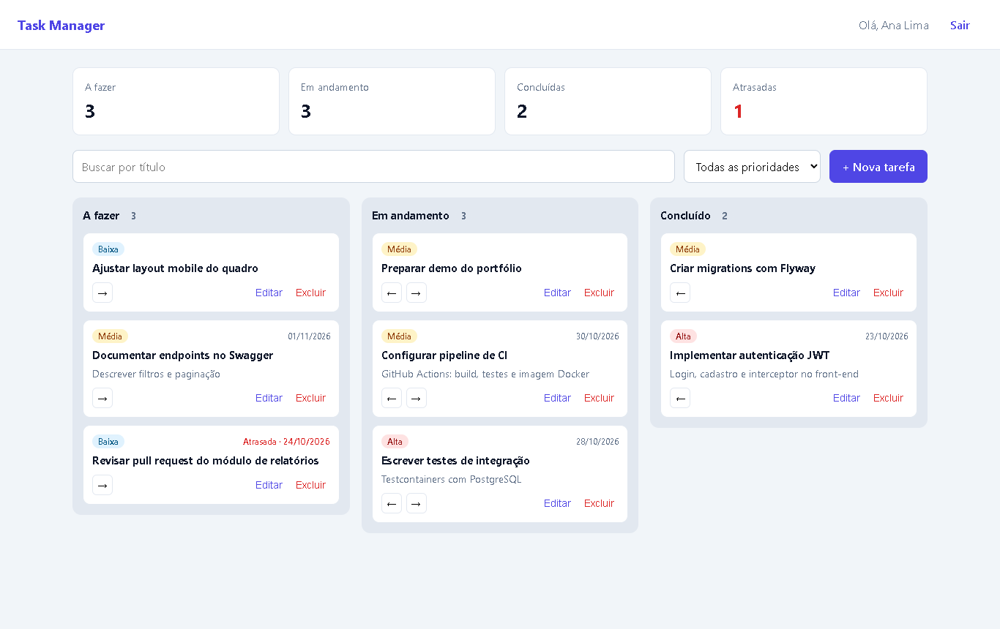
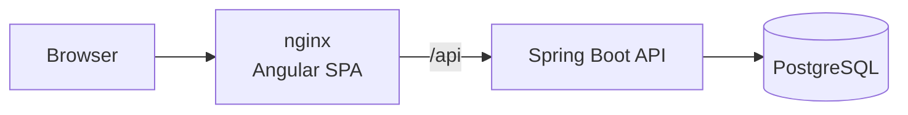
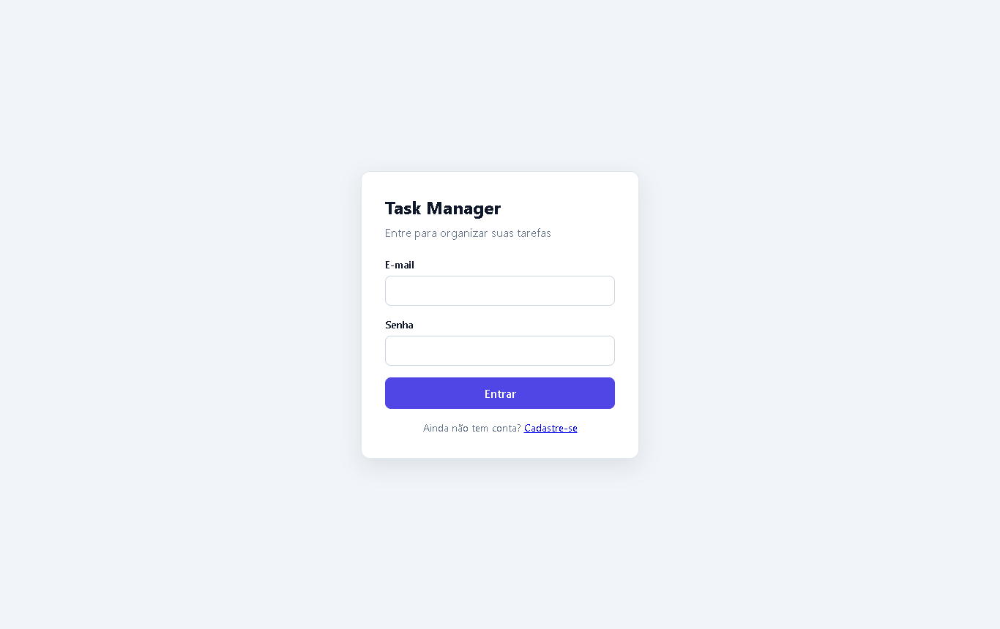

# Task Manager · Angular + Spring Boot


**Full stack** task management app with a Kanban board: an **Angular** front-end and a **Java / Spring Boot** REST API, with **JWT** authentication and a **PostgreSQL** database, all packaged with **Docker Compose**.



## Features

- Sign-up and login with JWT; routes protected by a guard and the token attached by an HTTP interceptor
- Board with **To do**, **In progress** and **Done** columns, with drag and drop
- Create and edit tasks in a modal with reactive forms and validation
- Priority (low, medium, high), due date and highlighting of **overdue** tasks
- Title search (debounced) and priority filter
- Summary with totals per status and number of overdue tasks
- Optimistic updates when moving cards: the UI changes instantly and rolls back if the API call fails
- Each user only sees their own tasks (the API returns 404 for other users' tasks)
- Session ends automatically when the token expires (401)

## Tech stack

| | Technologies |
|---|---|
| **Front-end** | Angular 22 (standalone components, signals, new control flow, lazy loading), TypeScript, RxJS, Reactive Forms, SCSS |
| **Back-end** | Java 21, Spring Boot 4.1, Spring Security (OAuth2 Resource Server / JWT), Spring Data JPA, Hibernate, Flyway, springdoc-openapi |
| **Database** | PostgreSQL 17 |
| **Testing** | Vitest + HttpTestingController (front-end), JUnit 5 + MockMvc + Testcontainers (back-end) |
| **Infrastructure** | Multi-stage Docker, nginx (serves the SPA and proxies the API), Docker Compose, GitHub Actions |

## Architecture



```
├── backend/                  # Spring Boot API
│   └── src/main/java/com/andresouza/tasks
│       ├── task/             # Task entity, repository, service, controller and DTOs
│       ├── user/             # Users, sign-up and login
│       ├── security/         # JWT and Spring Security configuration (CORS, stateless)
│       └── exception/        # Error responses in Problem Details format
└── frontend/                 # Angular
    └── src/app
        ├── core/             # AuthService, interceptor, guards, TaskService, models
        └── features/
            ├── auth/         # Login and sign-up
            └── board/        # Kanban board and task form
```

## Getting started

### With Docker

```bash
docker compose up --build
```

- App: http://localhost:4200 (create an account on the sign-up screen)
- API / Swagger: http://localhost:8080/swagger-ui.html

### Development mode

```bash
# Database
docker compose up -d postgres

# API (port 8080)
cd backend && ./mvnw spring-boot:run

# Front-end (port 4200, proxying to the API)
cd frontend && npm install && npm start
```

## Tests

```bash
cd backend && ./mvnw verify               # integration tests against real PostgreSQL (Testcontainers)
cd frontend && npx ng test --watch=false  # unit tests with Vitest
```

## Main endpoints

| Method | Route | Description |
|---|---|---|
| POST | `/api/auth/register` | Sign-up |
| POST | `/api/auth/login` | Login (returns a JWT) |
| GET | `/api/tasks?status=&priority=&search=` | Lists the user's tasks |
| GET | `/api/tasks/summary` | Totals per status and overdue count |
| POST | `/api/tasks` | Creates a task |
| PUT | `/api/tasks/{id}` | Updates a task |
| PATCH | `/api/tasks/{id}/status` | Moves a task between columns |
| DELETE | `/api/tasks/{id}` | Deletes a task |

<details>
<summary>Login screen</summary>


</details>

## Author

**André Souza** · Full Stack Java Developer
[LinkedIn](https://www.linkedin.com/in/andre-souza-ti) · [GitHub](https://github.com/AndreSouzaTI)
