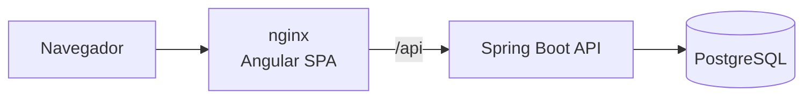

# Task Manager · Angular + Spring Boot


Aplicação **full stack** de gestão de tarefas em quadro Kanban: front-end em **Angular** e API REST em **Java com Spring Boot**, autenticação **JWT** e banco **PostgreSQL**, tudo empacotado com **Docker Compose**.


## Funcionalidades

- Cadastro e login com JWT; rotas protegidas por guard e token anexado por interceptor HTTP
- Quadro com as colunas **A fazer**, **Em andamento** e **Concluído**, com arrastar e soltar
- Criação e edição em modal com formulários reativos e validação
- Prioridade (baixa, média, alta), prazo e destaque para tarefas **atrasadas**
- Busca por título (com debounce) e filtro por prioridade
- Resumo com totais por status e quantidade de atrasadas
- Atualização otimista ao mover cards: a tela muda na hora e volta atrás se a API falhar
- Cada usuário só enxerga as próprias tarefas (a API responde 404 para tarefas de outros usuários)
- Sessão encerrada automaticamente quando o token expira (401)

## Stack

| | Tecnologias |
|---|---|
| **Front-end** | Angular 22 (standalone components, signals, novo control flow, lazy loading), TypeScript, RxJS, Reactive Forms, SCSS |
| **Back-end** | Java 21, Spring Boot 4.1, Spring Security (OAuth2 Resource Server / JWT), Spring Data JPA, Hibernate, Flyway, springdoc-openapi |
| **Banco** | PostgreSQL 17 |
| **Testes** | Vitest + HttpTestingController (front), JUnit 5 + MockMvc + Testcontainers (back) |
| **Infra** | Docker multi-stage, nginx (serve o SPA e faz proxy da API), Docker Compose, GitHub Actions |

## Arquitetura



```
├── backend/                  # API Spring Boot
│   └── src/main/java/com/andresouza/tasks
│       ├── task/             # Entidade, repositório, serviço, controller e DTOs de tarefas
│       ├── user/             # Usuários, cadastro e login
│       ├── security/         # JWT e configuração do Spring Security (CORS, stateless)
│       └── exception/        # Respostas de erro no padrão Problem Details
└── frontend/                 # Angular
    └── src/app
        ├── core/             # AuthService, interceptor, guards, TaskService, modelos
        └── features/
            ├── auth/         # Login e cadastro
            └── board/        # Quadro Kanban e formulário de tarefa
```

## Como executar

### Com Docker

```bash
docker compose up --build
```

- Aplicação: http://localhost:4200 (crie uma conta na tela de cadastro)
- API / Swagger: http://localhost:8080/swagger-ui.html

### Em modo desenvolvimento

```bash
# Banco
docker compose up -d postgres

# API (porta 8080)
cd backend && ./mvnw spring-boot:run

# Front-end (porta 4200, com proxy para a API)
cd frontend && npm install && npm start
```

## Testes

```bash
cd backend && ./mvnw verify               # integração com PostgreSQL real (Testcontainers)
cd frontend && npx ng test --watch=false  # unitários com Vitest
```

## Endpoints principais

| Método | Rota | Descrição |
|---|---|---|
| POST | `/api/auth/register` | Cadastro |
| POST | `/api/auth/login` | Login (retorna JWT) |
| GET | `/api/tasks?status=&priority=&search=` | Lista tarefas do usuário |
| GET | `/api/tasks/summary` | Totais por status e atrasadas |
| POST | `/api/tasks` | Cria tarefa |
| PUT | `/api/tasks/{id}` | Edita tarefa |
| PATCH | `/api/tasks/{id}/status` | Move entre colunas |
| DELETE | `/api/tasks/{id}` | Exclui tarefa |

<details>
<summary>Tela de login</summary>


</details>

## Autor

**André Souza** · Desenvolvedor Java Full Stack
[LinkedIn](https://www.linkedin.com/in/andre-souza-ti) · [GitHub](https://github.com/AndreSouzaTI)
